# Deployment Operations Automation

**An n8n case study in speeding up deployment coordination and documentation.**

I was the primary DevOps engineer responsible for 47 production servers. Deployments for government tender-related projects involved provisioning cloud infrastructure, configuring applications and domains, setting up messaging channels, and keeping a reliable record of the work. I used n8n and custom integrations to reduce repeated entry and link operational records across tools.

**Measured throughput:** Approximately **5–10 deployments per day before automation** and **20–30 per day after introducing automation**. These are historical observations for the broader deployment process, not an isolated benchmark of n8n.

## D01 Automation at a glance

[Editable Mermaid source](docs/diagrams/d01-automation-at-a-glance.mmd)

**How to read it:** n8n coordinates recordkeeping and calls FastAPI helpers for Telegram and Nextcloud operations. Server provisioning, DNS, firewalls and application rollout remain outside what the reviewed workflow establishes.

## Documentation

- [Engineering documentation](docs/index.md): reading paths, evidence labels, and all 17 sections.
- [Before and after](docs/process.md): what changed, what stayed manual, and the documentation lifecycle.
- [Requirements](docs/requirements.md) and [workflow architecture](docs/workflow.md): diagrams, integrations, and traceability.
- [Impact and engineering decisions](docs/case-study.md): historical results, limitations, and next steps.

This is a sanitized, documentation-only portfolio. The original workflow and operational evidence are not included. The workflow was reviewed statically and not executed; neither reviewed snapshot establishes a working GitLab trigger.
