# Personal n8n hosting appendix

[Documentation index](index.md)

This separate lab documents where I self-host n8n for personal automation. It does not establish the hosting, routing or runtime of the historical workplace workflow.

## Evidence

| Status | Observation |
| --- | --- |
| Probe-verified | Ubuntu 26.04 and an active Docker host service on the homelab; a Compose executable candidate was found. |
| Operator-confirmed | The homelab is a Windows Hyper-V Ubuntu VM; n8n, two custom automation helpers, and a separate FastAPI backend run in Docker there. |
| Operator-confirmed | A DigitalOcean Ubuntu gateway on KVM provides public IPv4 ingress for the lab behind CGNAT. The hosts are direct WireGuard peers, and gateway Apache reverse-proxies to the homelab at the host boundary. |
| Operator-confirmed | The homelab uses Docker Engine 29.4.1 and Docker Compose v5.1.3. Application stacks are deployed manually and use bridge networks and named volumes. This is the host pattern, not an inventory of n8n attachments. |
| Unknown | n8n image/version, Compose project membership, execution mode, datastore, persistence layout, live settings, and helper call paths. |
| Unknown | n8n exposure, proxy routes, TLS termination, webhook routing, and whether any application traffic traverses WireGuard. |
| Operator-confirmed gap | No backup strategy is implemented. No restore has been verified for this deployment. |

The restricted inventory did not observe a native n8n service or executable. That does not conflict with the operator-confirmed Docker deployment.

## D11 Personal n8n hosting context

**Purpose:** Describe where the personal n8n container runs without implying public exposure or employer-workflow connections.

[Editable Mermaid source](diagrams/d11-personal-n8n-hosting-context.mmd)

**How to read it:** The arrows show where containers run, not what they call. The public gateway reported above reaches the homelab boundary; no n8n route is drawn. Co-location does not confirm webhook exposure, shared resources, or calls between applications. No automated deployment is confirmed. See [helper service boundaries](helper-services.md) for what can be documented without inferring integrations.

## Synthetic example scope

[The Compose example](../examples/compose.example.yaml) illustrates a single n8n container with a named example data volume and no port published to the host. It does not add a database, Redis, a helper service, an ingress path, an encryption setting, or a workflow. None of these example choices describe or change either server. The [sample environment](../examples/compose.env.example) only provides a placeholder for the image reference.

Syntax validation with `docker compose config --quiet` does not pull an image, run n8n, confirm authentication, or demonstrate a restore. Before planning a real deployment, confirm the supported image and execution mode, persistence and recovery requirements, secrets provisioning, access policy, and routing/TLS design separately. Keep real configuration out of this repository.
