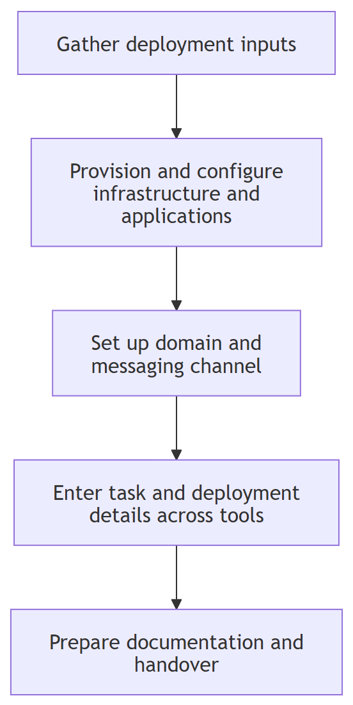
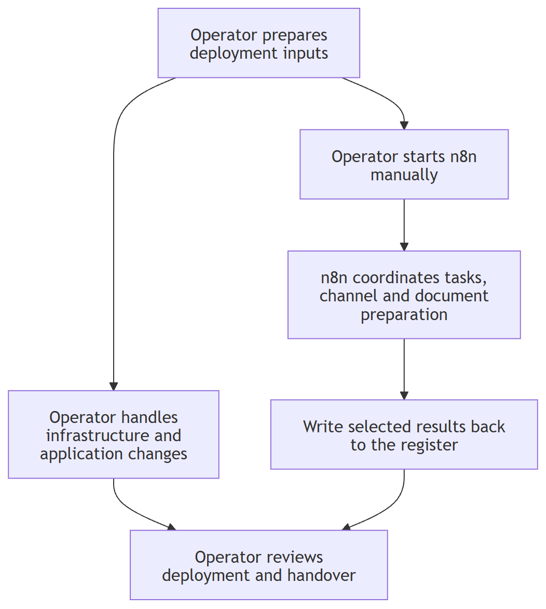
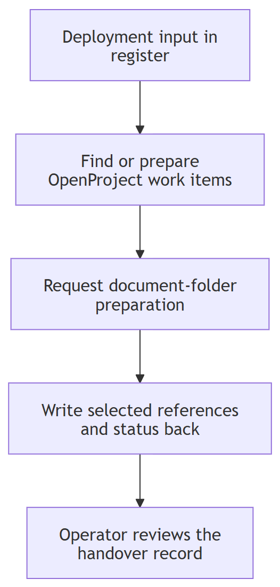

# Business process and deployment documentation

[Documentation index](index.md) · [Workflow architecture](workflow.md) · [Impact](case-study.md#14-measured-business-impact)

## 1. Project introduction

I built deployment support automation while working as the primary DevOps engineer responsible for 47 production servers. I used n8n to move repeatable coordination and documentation work into a workflow while retaining operator control over infrastructure changes. The reviewed workflow is one part of that broader deployment operation.

## 2. Business problem and operational context

Deployment meant both changing systems and recording what had changed. For government tender-related projects, the record had to stay useful for handover. Work included provisioning cloud capacity, setting up applications and domains, creating messaging channels, and maintaining deployment records. Re-entering the same details in a spreadsheet, project tracker, messaging service, and document store added effort and made it easier for those records to diverge. The reviews here do not establish that the workflow enforced a tender or compliance standard.

## 3. Project objectives

- Reduce repeated entry when turning deployment inputs into work items and documentation references.
- Reuse existing work items where the workflow finds a match rather than create them unconditionally.
- Make channel setup and document-folder preparation callable from a repeatable, manually initiated process.
- Preserve a traceable handoff in the deployment register without presenting a spreadsheet update as proof of service readiness.
- Keep cloud provisioning, firewall changes, DNS changes and application rollout separate from claims about the reviewed n8n workflow.

## 4. Manual deployment process

### D03 Before automation

**Purpose:** Show the distinct engineering and coordination work the operator had to perform.

[Editable Mermaid source](diagrams/d03-before-automation.mmd) · [SVG version](diagrams/d03-before-automation.svg)

**How to read it:** This is a generalized historical process, not a mandatory step order for every project. The repeated work was moving deployment context from one tool to another while doing the infrastructure work itself.

## 5. Automated deployment process

### D04 After introducing automation

**Purpose:** Show the operator's work alongside the records and handoffs automated in n8n.

[Editable Mermaid source](diagrams/d04-after-introducing-automation.mmd) · [SVG version](diagrams/d04-after-introducing-automation.svg)

**How to read it:** The two arms describe ownership, not a verified execution schedule. n8n coordinates the support work shown on its arm; the diagram does not assign it server provisioning, firewall changes, DNS changes, or rollout. The review step represents the operator's responsibility, not an automated approval gate.

### D10 Deployment documentation lifecycle

**Purpose:** Show how a deployment record gains task and documentation references for handover.

[Editable Mermaid source](diagrams/d10-deployment-documentation-lifecycle.mmd) · [SVG version](diagrams/d10-deployment-documentation-lifecycle.svg)

**How to read it:** OpenProject work items give the documentation a tracking reference; the workflow calls a helper for Nextcloud folder-related work and then writes selected results to the sheet. The supporting deployment notes describe Nextcloud upload and retrieval practices and a separate GitLab CI context. They do not prove that n8n generated the full tender pack, published documents, or was triggered by GitLab. Final handover review remains with the operator.
