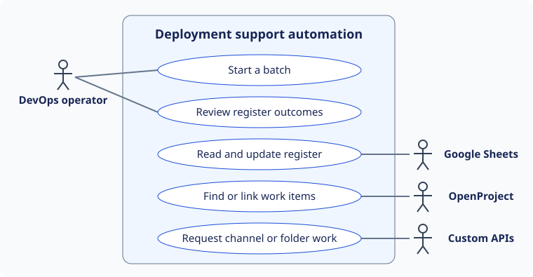

# Requirements and use cases

[Documentation index](index.md) · [Business process](process.md) · [Workflow](workflow.md)

## 6. Functional requirements

These retrospective requirements describe configured behavior at the boundary visible in the saved exports. They are not signed-off business requirements or evidence of runtime acceptance.

| ID | Requirement | Evidence and design trace | Candidate acceptance check; not run |
| --- | --- | --- | --- |
| AUT-01 | Let an operator start processing a set of deployment inputs. | Manual Trigger reaches the Sheets read in both snapshots. [D04](process.md#d04-after-introducing-automation), [D06](workflow.md#d06-workflow-activity) | Start with a synthetic batch and verify there is no dependency on a CI event. |
| AUT-02 | Select eligible rows and keep their original row association through processing. | Code nodes normalize and filter fields, then carry row context into merges. [D06](workflow.md#d06-workflow-activity), [D08](workflow.md#d08-data-flow) | Mix pending and done rows and inspect what advances; reorder rows during a mock run to test match assumptions. |
| AUT-03 | Find or prepare tracking records and create relevant task relationships. | OpenProject lookup, conditional create and relationship requests are configured. [D06](workflow.md#d06-workflow-activity), [D09](workflow.md#d09-component-architecture) | Use a mock tracker with found and missing work items; verify no unconditional creation and inspect relationship targets. |
| AUT-04 | Request a messaging channel and document-folder preparation through helpers. | Connected HTTP nodes request channel creation and folder-related actions. [D02](workflow.md#d02-system-context), [D07](workflow.md#d07-integration-sequence) | Mock both integrations, then simulate a successful channel action followed by a failed folder request. |
| AUT-05 | Correlate server-related information without claiming to provision a server. | Connected helper requests carry server context and include a Vultr-related lookup. [D09](workflow.md#d09-component-architecture), [custom API responsibilities](helper-services.md#12-custom-api-responsibilities) | Assert mock requests carry only approved data and do not issue a cloud provisioning action. |
| AUT-06 | Update selected results on the corresponding register row. | Two Sheets update nodes use row matching; they do not test workload readiness. [D08](workflow.md#d08-data-flow), [D10](process.md#d10-deployment-documentation-lifecycle) | Simulate a partial result and a failed writeback; verify the operator can tell what did and did not complete. |

## 7. Non-functional requirements and quality considerations

No measured service targets or formal acceptance sign-off are established by the evidence.

| Concern | Existing approach or limitation | Improvement criterion |
| --- | --- | --- |
| Traceability | Row mapping, work-item links and selected writeback fields preserve context; a row update is not proof of deployment. | Reconcile each side effect to a run and an input record without exposing private data. |
| Reliability and repeatability | Lookup-before-create limits unconditional task writes; a partial run may leave independent effects. | Prove retry behavior and safe recovery with duplicates, timeouts and failed writeback. |
| Operator control | The export begins manually; no automatic GitLab trigger is shown. | Make an operator's intended run and replay scope explicit. |
| Maintainability | n8n handles orchestration; HTTP requests isolate helper-backed operations. | Document and mock contracts; verify response shape changes before releases. |
| Confidentiality | The portfolio omits real data, configuration and workforce/customer identifiers. Actual credential scopes and handling are not audited here. | Keep evidence private and exercise only synthetic data in a separate environment. |

## 8. Actors and use cases

The **DevOps operator** supplies input, starts the automation, and reviews the deployment handover. Sheets, OpenProject and the helper integrations are supporting systems, not human roles. The portfolio does not assume a separate approver or an automated acceptance gate.

### D05 UML use cases

**Purpose:** Show what an operator expects from the automation and which supporting systems participate.

[Editable PlantUML source](diagrams/use-cases.puml)

**How to read it:** Ovals are goals inside the automation boundary; lines are actor associations, not order or APIs. Reviewing register outcomes is a manual goal, not a workflow-generated approval state. Cloud and application changes stay outside this boundary.
