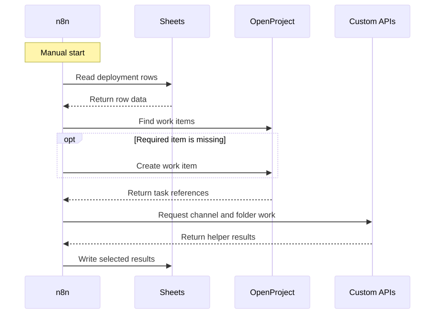

# Workflow design and integrations

[Documentation index](index.md) · [Custom APIs](helper-services.md#12-custom-api-responsibilities) · [Operational limits](case-study.md#13-error-handling-and-operational-limitations)

## 9. Workflow architecture

### D02 System context

**Purpose:** Locate n8n between the operator, deployment register, work tracker, and helper-backed services.

[Editable Mermaid source](diagrams/d02-system-context.mmd)

**How to read it:** The operator owns the run. Sheets is the input and writeback surface, OpenProject tracks the work, and custom integrations handle service-specific operations. The last two links denote the business destinations, not direct n8n connections.

### D06 Workflow activity

**Purpose:** Explain the configured manual path and the distinction between reuse and creation.

[Editable Mermaid source](diagrams/d06-workflow-activity.mmd)

**How to read it:** This groups repeated lookups, branches and loops by purpose. Multiple work item lookups and creation checks are configured. The helper and relation paths branch, so the simplified order does not imply a single serial transaction or successful completion for every row.

### D09 Component architecture

**Purpose:** Separate the orchestration, direct connectors and custom API boundaries.

[Editable Mermaid source](diagrams/d09-component-architecture.mmd)

**How to read it:** Sheet nodes and OpenProject calls are visible in the exports. The custom API nodes are visible as callers' HTTP requests. Their responsibility is described at that boundary, not as a reconstruction of the private service code or its hosting layout.

### Configuration and trigger states

| State | What the evidence supports |
| --- | --- |
| Manually triggered | Each reviewed snapshot contains a Manual Trigger linked to the Sheets read. Neither contains an automatic GitLab trigger or webhook entry. |
| Configured and connected | Both snapshots connect row preparation, OpenProject work-item and relation operations, channel creation and document-folder helper requests, server-related helper calls, and sheet updates to the manual entry. Graph reachability is not evidence of runtime success. |
| Configured but disconnected in one snapshot | A separate server/document helper request has no path from Manual Trigger in one snapshot. In the other it is wired into a result merge that feeds sheet updates. It is not part of the shared baseline and its execution is unverified. |
| Documented separately | Supporting notes describe GitLab CI deployment context and manual triggers in that deployment context. This does not establish a GitLab-to-n8n trigger or a connection between the two run histories. |
| Live state unknown | The saved snapshots do not assert an active workflow, valid credential bindings, public access, or a current deployment state. |

## 10. External service integration

| Service | Role in the reviewed workflow | Verification boundary |
| --- | --- | --- |
| Google Sheets | Read deployment rows and update selected columns by row match after processing. | Sheet operations configured; no live read or write verified. |
| OpenProject | Look up and conditionally create work packages (tracked tasks), then post work-item relationships. | Server-related work packages are project records, not cloud instances. |
| Telegram | Channel creation is requested through a custom integration. | No live channel creation, membership management, or message delivery verified. |
| Nextcloud WebDAV | A custom helper is called for deployment-folder and related documentation metadata. | Storage-side implementation and file delivery for an individual run are not verified. |
| Custom FastAPI integrations | HTTP handoff for channel, folder, and server-related operations. | No service source, auth setup, route details or remote success is asserted. |
| GitLab | Separate deployment documentation mentions it. | No executable GitLab trigger is evidenced in the reviewed workflow snapshots. |

### D07 Integration sequence

**Purpose:** Show the handoffs for an illustrative successful batch, not a captured run.

[Editable Mermaid source](diagrams/d07-integration-sequence.mmd)

**How to read it:** The diagram shows the shared path at service level. It leaves out repeated lookups, relationship calls, server metadata calls, and variant-only branches to keep the handoff readable. The return messages are illustrative, not verified live responses.

## 11. Data flow and validation

### D08 Data flow

**Purpose:** Show how a spreadsheet row is carried through preparation, enrichment and writeback.

[Editable Mermaid source](diagrams/d08-data-flow.mmd)

**How to read it:** Arrows show data dependencies, not timing. The orchestrator normalizes strings and status values, filters out rows marked done, and prepares row and server/domain context. Work-item ID checks govern reuse versus creation. Merge and mapping steps carry row context and selected references back to the deployment register. These checks are not a schema validation service, an independent verification of the deployment, or a concurrency guarantee.

The documented fields are categories, not copied column names: row match identifier, deployment status, server/domain context, task references, and channel/document references. No source row, real identifier, or original payload is included.
